# ShiftFlow — A Human-Centered Operations Tool

ShiftFlow is a self-directed web application designed to help small food-service teams organize end-of-shift operations in one centralized system.

The project was inspired by challenges I observed in a fast-paced food-service environment, where shift leaders need to monitor inventory, complete shift responsibilities, track employee training, and communicate important information between shifts.

## Live Demo

Try the deployed version of ShiftFlow:

[Open ShiftFlow Live Demo](https://shiftflow-operations.streamlit.app/)

## Features

### End-of-Day Inventory

Employees can record how much inventory remains at the end of a shift.

To make inventory entry faster, ShiftFlow includes quick quantity buttons:

- 0
- 5
- 10
- 15
- 20

Exact quantities can also be adjusted manually.

The application automatically classifies each inventory item as:

- ✅ In Stock
- ⚠️ Low Stock
- 🚨 Out of Stock

Different items use different internal minimum quantities based on operational needs.

### Shift Tasks

ShiftFlow includes a checklist for common shift responsibilities, including:

- Checking inventory
- Preparing toppings
- Cleaning drink stations
- Cleaning drains
- Taking out trash
- Organizing supplies
- Cleaning syrup and sugar areas
- Sweeping and mopping
- Turning off equipment
- Wiping down work surfaces

Task progress can be saved separately for Opening and Closing shifts.

### Training Tracker

Employee training can be tracked across four work stations:

- Prep
- Barista
- Cashier
- Expo

Each employee can be assigned a station and a training progress percentage.

### Daily Reports

Shift leaders can create Opening and Closing reports containing:

- Date
- Shift
- Shift leader
- Number of employees working
- Daily notes
- Issues requiring follow-up
- Inventory status
- Completed shift tasks
- Employee training information

If a report already exists for the same date and shift, ShiftFlow updates the existing report instead of creating a duplicate.

### Report History

Previous reports can be reviewed later to see:

- Inventory quantities and status
- Completed and incomplete tasks
- Daily operational notes
- Follow-up issues
- Employee training progress

## Screenshots

### Dashboard

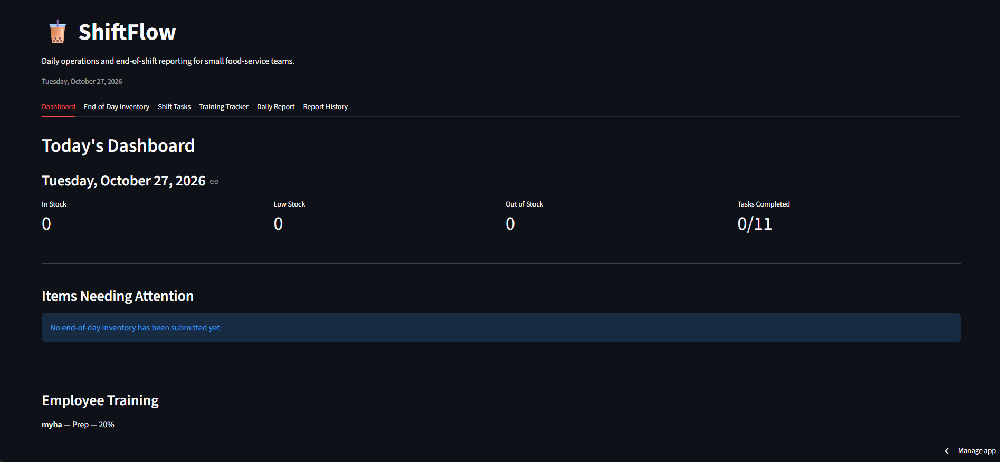

### End-of-Day Inventory

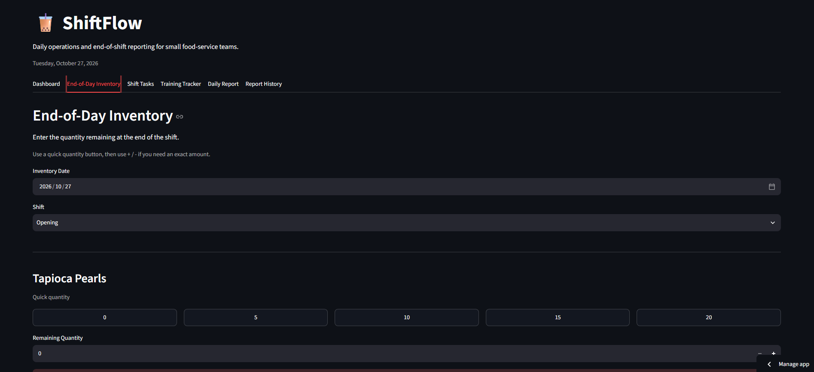

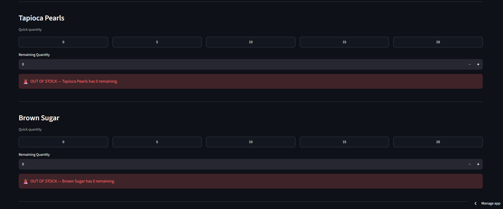

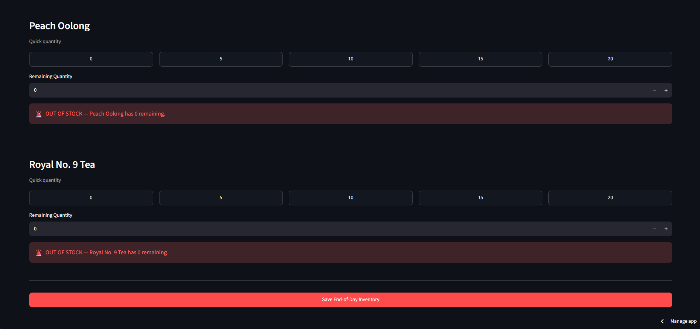

### Shift Tasks

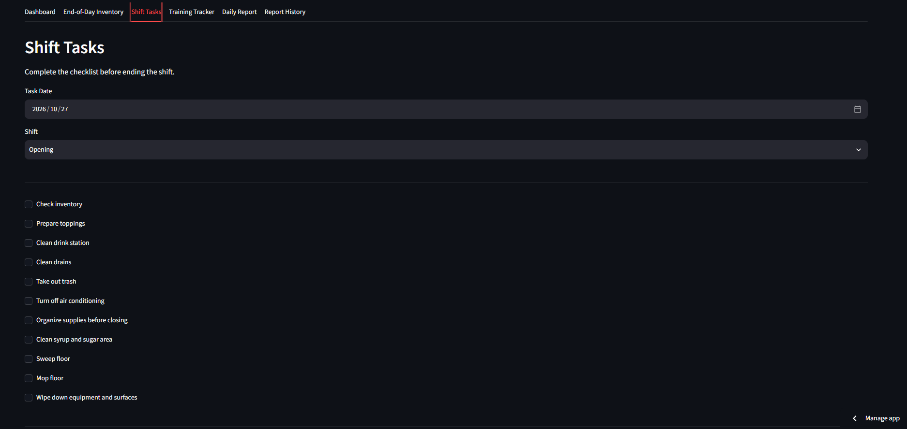

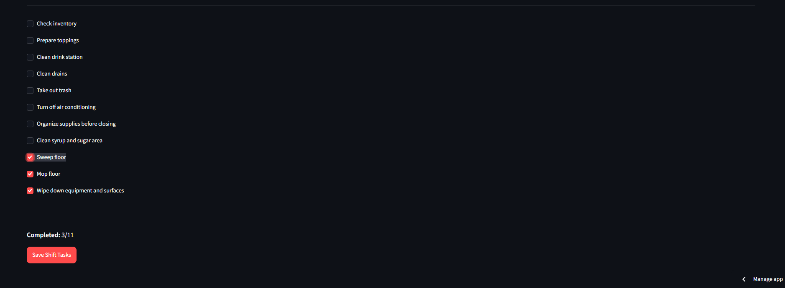

### Training Tracker

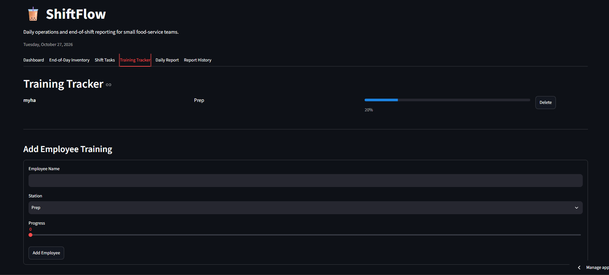

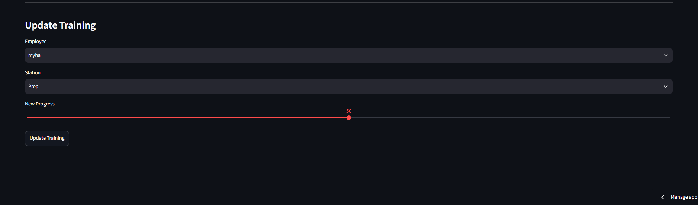

### Daily Report

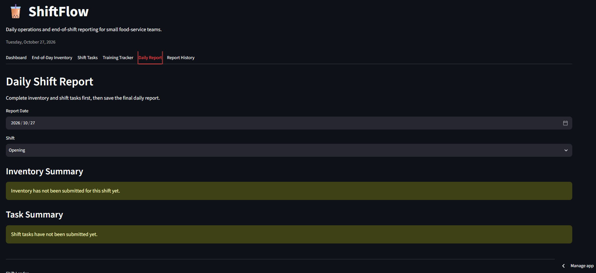

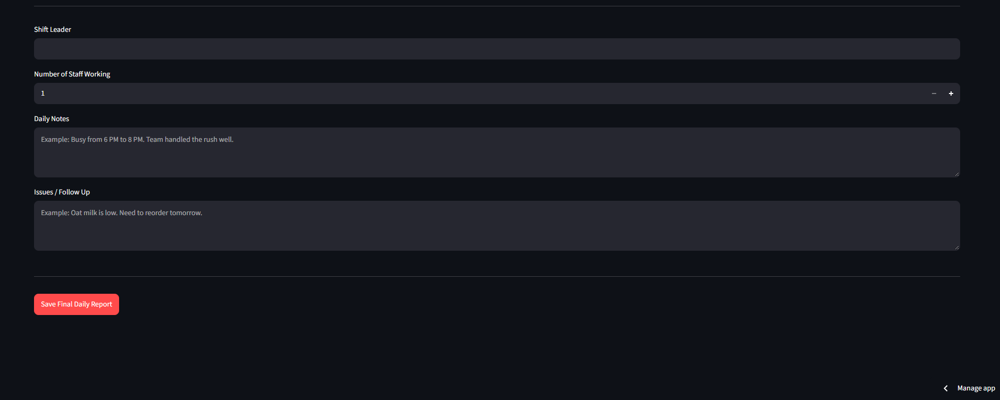

### Report History

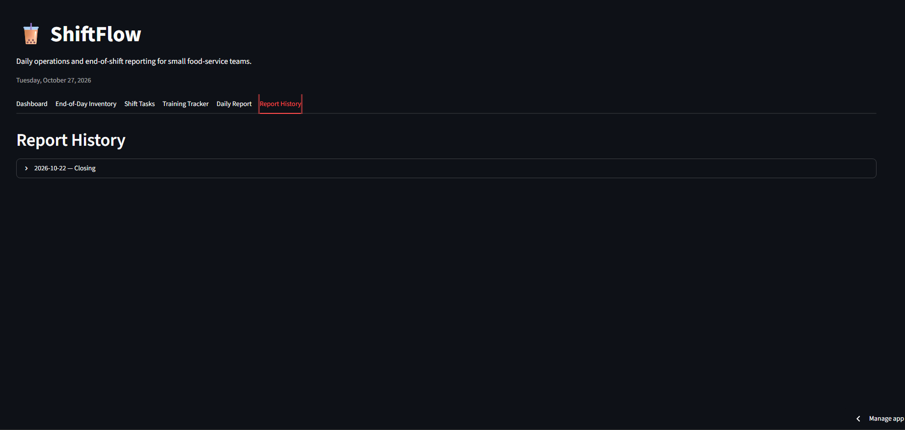

## Technologies

- Python
- Streamlit
- JSON
- GitHub
- Streamlit Community Cloud

## Installation

Clone or download the repository.

Install the required dependency:

```bash
pip install -r requirements.txt
```

Run ShiftFlow:

```bash
py -m streamlit run app.py
```

The application will open through Streamlit in your browser.

On Windows, the included `run_app.bat` file can also be used to launch the application locally.

## Project Structure

```text
ShiftFlow/
├── app.py
├── requirements.txt
├── README.md
├── DESIGN_PROCESS.md
├── run_app.bat
└── screenshots/
    ├── dashboard.png
    ├── inventory1.png
    ├── inventory2.png
    ├── inventory3.png
   
